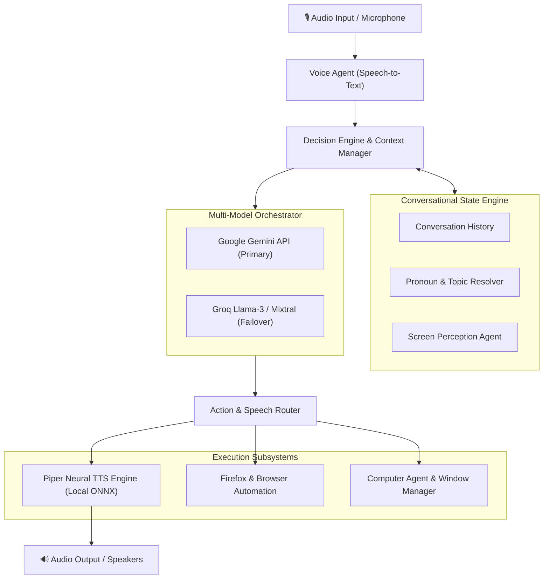

<div align="center">

# 🐰 RoboRabbit

### Autonomous Voice AI Companion & Desktop Assistant

*A real-time, voice-first intelligent assistant featuring low-latency local neural TTS, screen perception, browser automation, and multi-model failover.*

[](https://python.org)
[](https://fastapi.tiangolo.com)
[](https://github.com/rhasspy/piper)
[](https://websockets.readthedocs.io)
[](https://github.com/Scempyyy/Roborabbit)

[Explore Codebase](https://github.com/Scempyyy/Roborabbit) · [Report Issue](https://github.com/Scempyyy/Roborabbit/issues) · [Feature Request](https://github.com/Scempyyy/Roborabbit/issues)

</div>

---

## 📖 Overview

**RoboRabbit** is an experimental personal voice AI assistant that bridges conversational intelligence with native desktop execution. Unlike cloud-only assistants that lag or charge for every audio token, RoboRabbit runs local neural speech synthesis via **Piper**, maintains persistent multi-turn conversational memory, captures screen state for visual grounding, and orchestrates actions across your operating system and web browser.

---

## ⚡ Core Capabilities

- 🎙️ **Low-Latency Neural Speech Synthesis**: Integrates offline Piper TTS models with ONNX acceleration for natural, expressive voice responses in under 200ms.
- 🧠 **Context & Memory Resolution**: Stateful multi-turn conversation tracking (`context_manager.py`) and pronoun resolution (`context_resolver.py`) that maintains intent across queries.
- 🔄 **Resilient LLM Failover**: Hybrid brain architecture that routes prompts across multiple AI providers (Google Gemini, Groq LLMs) with automatic quota failover.
- 🖥️ **Screen Perception & Vision**: Captures live desktop displays and window context (`screen_agent.py`) to answer questions about what is currently visible on screen.
- 🌐 **Autonomous Browser & Desktop Automation**: Dedicated agents for Firefox interaction, tab navigation, research extraction, and system command execution.
- 🛡️ **Verified Execution & Smart Recovery**: Two-phase verification before running destructive actions, backed by self-healing recovery loops.

---

## 🏗️ System Architecture



---

## 📁 Project Structure

```text
Roborabbit/
├── main.py                     # Main assistant lifecycle & WebSocket server
├── voice_agent.py              # Voice processing and turn-taking loop
├── voice.py                    # Audio capture, playback, and stream handling
├── simple_voice.py             # Minimal headless speech pipeline
├── decision_engine.py          # Intent classification and prompt routing
├── hybrid_brain.py             # Multi-model LLM failover gateway
├── context_manager.py          # Multi-turn conversational memory buffer
├── context_resolver.py         # Entity & reference resolution
├── screen_agent.py             # Screen capture and visual inspection
├── computer_agent.py           # Native desktop automation and window focus
├── firefox_agent.py            # Headless and interactive browser automation
├── action_executor.py          # Command validation and dispatch engine
├── verified_executor.py        # Safe execution wrapper with confirmations
├── smart_recovery.py           # Self-healing retry logic on failure
├── tools/                      # Reusable toolkits (file I/O, search, shell)
├── .env.example                # Sanitized template for API keys
└── README.md                   # Project documentation
```

---

## 🚀 Getting Started

### Prerequisites
- **Python**: `3.10` or `3.11` (recommended)
- **Piper TTS**: Pre-compiled binary or Python package (`pip install piper-tts`)
- **System Audio**: `pulseaudio`, `pipewire`, or ALSA on Linux

### Quick Start

```bash
# 1. Clone the repository
git clone https://github.com/Scempyyy/Roborabbit.git
cd Roborabbit

# 2. Create and activate a Python virtual environment
python3 -m venv .venv
source .venv/bin/activate

# 3. Install required packages
pip install fastapi uvicorn websockets google-generativeai groq requests

# 4. Configure environment variables
cp .env.example .env
# Open .env and add your GEMINI_API_KEY and GROQ_API_KEY

# 5. Launch RoboRabbit
python3 main.py
```

---

## 🔐 Security & Local Privacy

- **Never Commit Secrets**: Keep all API keys in `.env`, which is strictly excluded in `.gitignore`.
- **Local Voice Synthesis**: Speech generation runs 100% on-device via Piper neural voices; raw audio is not transmitted to external vendors.
- **Sandboxed Automation**: Browser and command agents validate instructions against allowlists before executing system changes.

---

## 👥 Contributors & Activity Graph

<div align="center">

[](https://github.com/Scempyyy/Roborabbit/graphs/contributors)
[](https://github.com/Scempyyy/Roborabbit/pulse)
[](https://github.com/Scempyyy/Roborabbit/commits/main)

<br/><br/>

<a href="https://github.com/Scempyyy/Roborabbit/graphs/contributors">
  
</a>

<br/><br/>

[📊 View Full Repository Insights & Contribution Graph →](https://github.com/Scempyyy/Roborabbit/graphs/contributors)

</div>

---

## 📄 License

This project is licensed under the [MIT License](LICENSE).
